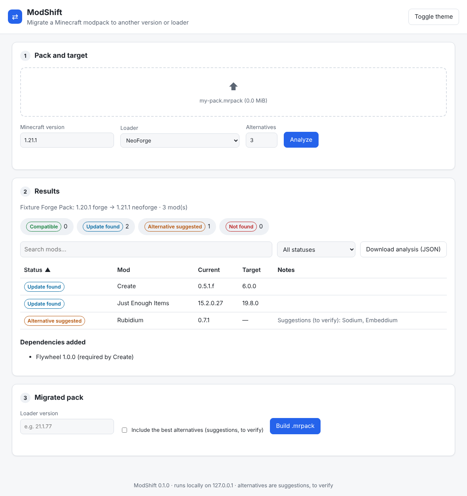
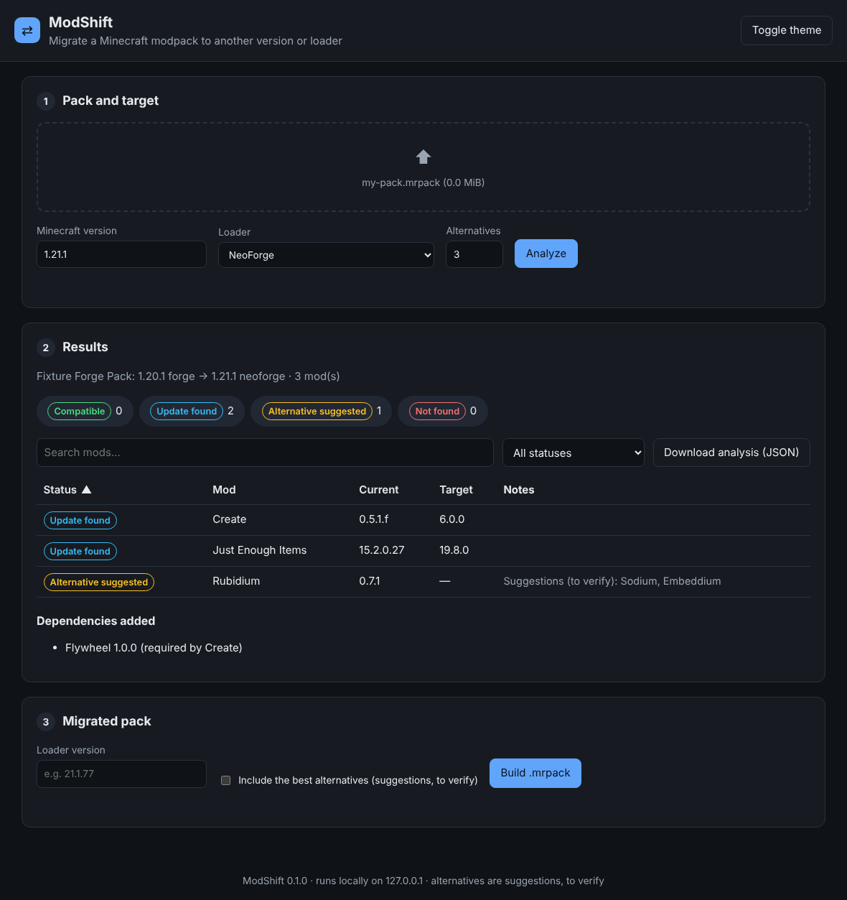

# ModShift

> Migrate a Minecraft modpack to another Minecraft version and/or mod loader.

[](https://github.com/NeyorDEV/ModShift/actions/workflows/ci.yml)
[](https://www.npmjs.com/package/modshift)
[](https://www.npmjs.com/package/modshift)
[](https://neyordev.github.io/ModShift/)


Moving a modpack from, say, **1.20.1 Forge** to **1.21.1 NeoForge** usually means checking every
mod by hand: is there a version for the new target? If not, what replaces it? Which dependencies
are now missing? **ModShift automates that.** It reads your pack, identifies each mod on
[Modrinth](https://modrinth.com), finds a compatible version, suggests alternatives, resolves
dependencies and can write a migrated `.mrpack`. Use it from the command line, through a guided
interactive mode, or in a small local web page.



_Screenshot of the test suite's fixture pack (fake data), analysed in `modshift ui`._

> ModShift does **not** convert mod code. It looks for versions or equivalents of your mods for
> the target. A mod with no port stays a mod with no port.

## Contents

Full documentation: the [`docs/`](docs/) site (VitePress, `npm run docs:dev`), to be published at
https://neyordev.github.io/ModShift/ once GitHub Pages is enabled.

- [Features](#features) · [Installation](#installation) · [Quick start](#quick-start)
- [Commands](#commands) · [Interactive mode](#interactive-mode) · [Web interface](#web-interface)
- [Options](#options) ([full reference](docs/cli.md)) · [Configuration file](#configuration-file)
- [Other sources](#other-sources-plugins) · [CurseForge packs](#curseforge-packs) · [Cache and offline mode](#cache-and-offline-mode)
- [Changing loader](#changing-loader-eg-forge--fabric) · [Client and server](#client-and-server)
- [GitHub Action](#github-action) · [Performance](#performance) · [Example output](#example-output)
- [How it works](#how-it-works) · [FAQ](#faq)
- [Limitations](#limitations) · [Programmatic API](#programmatic-api)
- [Contributing](#contributing) · [Security](#security) · [License](#license)

## Features

- **Inputs:** Modrinth `.mrpack`, CurseForge export `.zip` (`manifest.json`), or a folder of
  `.jar` files (an instance folder with `mods/`, or a server folder with `plugins/`).
- **Loaders:** Forge, NeoForge, Fabric, Quilt and older mod loaders; Bukkit, Spigot, Paper, Purpur
  and Sponge server plugins; BungeeCord, Waterfall and Velocity proxies. Documented cross-loader
  compatibility (e.g. Fabric mods on Quilt) is reported as "fallback compatibility, to test".
- **Identification:** by SHA-1/SHA-512 hash on Modrinth (exact). As a fallback, the jar's mod id
  (`fabric.mod.json`, `quilt.mod.json`, `mods.toml`, `neoforge.mods.toml`) is tried as a Modrinth
  slug, reported as _unverified_.
- **Status for every mod:**
  - `compatible`: your current file already supports the target;
  - `update found`: another version of the same project does;
  - `alternative suggested`: no version, but similar mods exist. These are **suggestions, to
    verify**;
  - `not found`: nothing usable, with the reason.
- **Changing loader** (e.g. Forge → Fabric): multi-loader mods keep the same project; other mods
  get alternatives ranked by relevance, each with an explanation. Mods a compatibility layer could
  load are flagged as **experimental, not guaranteed**, never added automatically.
- **Dependencies:** missing required dependencies are added. Missing dependencies,
  incompatibilities, pinned versions and duplicates are explained.
- **Migration:** `modshift migrate` writes a new `.mrpack` that follows Modrinth's own validation
  rules, plus a `MIGRATION_REPORT.md` listing what was excluded and why.
- **Reports:** console table, JSON or Markdown.
- **Offline-friendly:** a local cache of API responses, `--offline`, and `modshift cache` commands.
- **Configurable:** an optional `modshift.config.json` with a default target, ignore and exclude
  lists and manual mappings, written for you by the interactive mode.
- **Three ways to use it:** CLI commands for scripts and CI, `modshift interactive` to decide mod
  by mod, and `modshift ui` for a local web page (127.0.0.1 only).
- **Polite to Modrinth:** explicit User-Agent, client-side rate limiting, retries with backoff.

## Installation

ModShift needs **Node.js 20.17+ or 22.13+**.

```bash
# From npm
npm install --global modshift

# From source
git clone https://github.com/NeyorDEV/ModShift.git
cd ModShift
npm ci
npm run build
npm link        # makes the `modshift` command available
```

## Quick start

```bash
# 1. What would break when moving to 1.21.1 NeoForge?
modshift analyze my-pack.mrpack --mc 1.21.1 --loader neoforge

# 2. Preview the migration without writing anything
modshift migrate my-pack.mrpack --mc 1.21.1 --loader neoforge --loader-version 21.1.77 \
  --out my-pack-1.21.1.mrpack --dry-run

# 3. Write the migrated pack and MIGRATION_REPORT.md
modshift migrate my-pack.mrpack --mc 1.21.1 --loader neoforge --loader-version 21.1.77 \
  --out my-pack-1.21.1.mrpack
```

## Commands

| Command                                         | What it does                                                        |
| ----------------------------------------------- | ------------------------------------------------------------------- |
| `modshift analyze <pack> --mc <v> --loader <l>` | Reports, mod by mod, what is available for the target.              |
| `modshift migrate <pack> … --out <file>`        | Writes a migrated `.mrpack` and a `MIGRATION_REPORT.md` next to it. |
| `modshift interactive [pack]` (or `-i`)         | Guided mode: review each mod, save your choices, build the pack.    |
| `modshift ui [--port <n>] [--no-open]`          | Local web interface on `http://127.0.0.1` (drag and drop a pack).   |
| `modshift cache stats [--json]`                 | Shows the size and age of the local cache.                          |
| `modshift cache clear [--expired]`              | Deletes cached API responses (all, or only expired ones).           |

`<pack>` is a `.mrpack`, a CurseForge export `.zip`, or a folder of `.jar` files. The format is
detected from the archive's content, not its extension.

## Interactive mode

```bash
modshift interactive my-pack.mrpack     # or simply: modshift -i
```

The assistant asks for the target Minecraft version and loader, shows the report, then lets you
decide, mod by mod (by default only the ones that need attention):

- **accept** the update (or keep the compatible version);
- **use one of the alternatives** (each still marked "suggestion, to verify");
- **exclude** the mod from migrated packs (it stays in reports);
- **ignore** it (no longer analysed).

Your choices are saved in `modshift.config.json` (as `mappings`, `exclude` and `ignore`, next to
the target), so they can be replayed by the non-interactive commands, for example in CI:

```bash
modshift migrate my-pack.mrpack --out my-pack-1.21.1.mrpack   # uses modshift.config.json
```

The interactive mode needs a terminal. In scripts it refuses to start; use `analyze` and `migrate`
instead. Press Ctrl+C at any time to quit without saving (exit code 130).

## Web interface

```bash
modshift ui            # opens http://127.0.0.1:<port>/ in your browser
modshift ui --port 8123 --no-open
```

A small local page to drop a `.mrpack` or CurseForge `.zip`, choose the target, browse the results
(sortable, filterable by status, with a detail view per mod: versions, alternatives,
dependencies), then download the migrated `.mrpack`, the `MIGRATION_REPORT.md` and the JSON
analysis. Light and dark themes follow your system, and a toggle overrides them.

<p align="center">
  
</p>

The server only listens on `127.0.0.1` and protects its API with a random token. Uploaded files
stay in a temporary folder that is deleted when you stop it (Ctrl+C). See [SECURITY.md](SECURITY.md).
The web interface uses the same cache and options as the CLI (`--offline`, `--cache-dir`,
`--cache-ttl`).

## Options

### Common to `analyze` and `migrate`

| Option                   | Description                                                                                                          |
| ------------------------ | -------------------------------------------------------------------------------------------------------------------- |
| `--mc <version>`         | Target Minecraft version (e.g. `1.21.1`). Required unless set in the config.                                         |
| `--loader <loader>`      | Target loader, e.g. `neoforge`, `fabric`, `paper` ([full list](docs/loaders.md)). Required unless set in the config. |
| `--side <side>`          | Installation the pack is for: `client`, `server` or `both` (default). See [Client and server](#client-and-server).   |
| `--config <file>`        | Configuration file (default: `./modshift.config.json` if it exists).                                                 |
| `--no-config`            | Ignore `modshift.config.json`.                                                                                       |
| `--offline`              | Only use cached API responses; never touch the network.                                                              |
| `--no-cache`             | Do not read or write the cache.                                                                                      |
| `--cache-dir <dir>`      | Cache directory (default below).                                                                                     |
| `--cache-ttl <duration>` | How long cached responses stay valid: `30m`, `12h`, `7d`, `0` (default `24h`).                                       |
| `--max-alternatives <n>` | Alternatives suggested per missing mod, `0`–`20` (default `3`).                                                      |
| `-q, --quiet`            | No progress output on stderr.                                                                                        |
| `-v, --verbose`          | Log every API request, cache hit and retry on stderr.                                                                |

### `analyze`

| Option                  | Description                                               |
| ----------------------- | --------------------------------------------------------- |
| `-f, --format <format>` | `table` (default), `json` or `markdown` (`md`).           |
| `-o, --output <file>`   | Write the report to a file instead of stdout.             |
| `--no-color`            | Plain table without colors (`NO_COLOR` is also honoured). |

### `migrate`

| Option                       | Description                                                                                                                    |
| ---------------------------- | ------------------------------------------------------------------------------------------------------------------------------ |
| `--out <file.mrpack>`        | Output pack (required). `MIGRATION_REPORT.md` is written in the same folder.                                                   |
| `--loader-version <version>` | Target loader version written into the pack. Needed unless the source pack already uses the same loader and Minecraft version. |
| `--include-alternatives`     | Include the best alternative for each mod without a version. It stays flagged as a suggestion in the report.                   |
| `--dry-run`                  | Show what would be done; write nothing.                                                                                        |
| `--force`                    | Overwrite `--out` if it exists.                                                                                                |

### Environment variables

| Variable             | Description                                                                  |
| -------------------- | ---------------------------------------------------------------------------- |
| `MODSHIFT_CACHE_DIR` | Cache directory (else `$XDG_CACHE_HOME/modshift`, else `~/.cache/modshift`). |
| `MODSHIFT_CACHE_TTL` | Default for `--cache-ttl`.                                                   |
| `CURSEFORGE_API_KEY` | Enables CurseForge resolution (see below). Never stored by ModShift.         |
| `GITHUB_TOKEN`       | Optional token for the GitHub Releases source. Never stored by ModShift.     |
| `NO_COLOR`           | Disables colors.                                                             |

### Exit codes

`0` when the command completes, whatever the mod statuses; `1` on errors (invalid options or pack,
network failure, offline cache miss…). Every error comes with a `hint:` line that says what to do.

## Configuration file

`modshift.config.json` (optional; JSON Schema in
[`schemas/modshift.config.schema.json`](schemas/modshift.config.schema.json)):

```json
{
  "$schema": "./schemas/modshift.config.schema.json",
  "target": { "minecraftVersion": "1.21.1", "loader": "neoforge", "loaderVersion": "21.1.77" },
  "ignore": ["optifine*.jar"],
  "exclude": ["old-minimap"],
  "mappings": { "rubidium": "embeddium", "my-local-mod.jar": "sodium" }
}
```

- `target`: defaults for `--mc`, `--loader`, `--loader-version` and `--side` (`side`).
  Command-line options win.
- `ignore`: mods left out entirely. Entries are file names (`*` wildcard), Modrinth slugs or
  project ids.
- `exclude`: mods that are analysed and reported, but left out of migrated packs (with the
  dependencies only they needed).
- `mappings`: "this mod → that Modrinth project". A mapping is your explicit choice, so it is
  reported as a replacement, not a suggestion. It also works for files Modrinth does not know.

- `sources`: options of [mod sources](docs/plugins.md), e.g. GitHub repositories to look at for
  mods that are not on Modrinth.

Unknown keys are rejected, so a typo cannot silently do nothing.

## Other sources (plugins)

Modrinth is the primary source. Other sources plug in through a small contract
([`docs/plugins.md`](docs/plugins.md)): CurseForge resolves export references (below), and
**GitHub Releases** looks for a matching `.jar` in repositories you list:

```json
{ "sources": { "github-releases": { "repositories": { "my-mod.jar": "someone/my-mod" } } } }
```

Files found this way are listed under "Other sources (to verify)" in the reports and are **never
added to the migrated pack** (matched by file name only). Third-party sources can be registered
through the programmatic API.

## CurseForge packs

A CurseForge export only lists project/file IDs. To identify them, ModShift needs the CurseForge
API, which requires a key:

```bash
export CURSEFORGE_API_KEY="…"   # from https://console.curseforge.com
modshift analyze my-export.zip --mc 1.21.1 --loader neoforge
```

ModShift fetches each file's name and SHA-1, then finds **the same jar on Modrinth** by hash. The
CurseForge slug is an unverified fallback. Nothing is downloaded from CurseForge. Without a key,
these mods are reported as not identified, with instructions; jars inside the export's
`overrides/` folder are analysed either way. Details in
[`docs/curseforge-api.md`](docs/curseforge-api.md).

## Cache and offline mode

API responses are cached as JSON files (24 h by default):

```bash
modshift analyze pack.mrpack --mc 1.21.1 --loader fabric            # fills the cache
modshift analyze pack.mrpack --mc 1.21.1 --loader fabric --offline  # no network at all
modshift cache stats
modshift cache clear --expired
```

In `--offline` mode, any cached entry is used whatever its age. A missing entry names the request
(for example "the hash lookup of 42 file(s)"). Uncached alternative searches are skipped with a
warning instead of failing the whole run.

## Changing loader (e.g. Forge → Fabric)

> **ModShift does not convert mod code.** A Forge mod cannot become a Fabric mod. ModShift looks
> for **equivalents**: the same mod published for the other loader, or a different mod that does
> a similar job.

For each mod, in this order:

1. **Same project, other loader.** Many mods are multi-loader: the same Modrinth project publishes
   Forge, NeoForge and Fabric versions. ModShift switches to the target loader's version and says
   so (`Same project: its Fabric version replaces the Forge one`). This is the safest outcome.
2. **Alternatives**, when the project has no version for the target. Candidates come from two
   Modrinth searches (similar name, same categories) filtered on the target, then are **ranked by
   relevance** (shared categories 40 %, similar name 30 %, popularity 20 %, keywords from the
   description 10 %). A candidate must have a similar name or share at least two meaningful keywords
   with the original's description: a popular mod that only shares a broad category (such as
   "utility") is not suggested. Each suggestion comes with its score and why it was chosen, for
   example
   `relevance 79/100 — similar name (minimap) · same categories (adventure, utility) · 1.0M downloads`.
   Alternatives are **suggestions, to verify**: a different mod is never a drop-in replacement
   (worlds, configs and recipes can differ).
3. **Compatibility layers.** Some third-party mods load mods made for another loader. ModShift
   knows only the combinations documented by their authors:

   | Layer                                                         | Loads       | On       | Minecraft | Also install                               |
   | ------------------------------------------------------------- | ----------- | -------- | --------- | ------------------------------------------ |
   | [Sinytra Connector](https://modrinth.com/mod/connector)       | Fabric mods | NeoForge | 1.21.1    | Forgified Fabric API (replaces Fabric API) |
   | [Sinytra Connector](https://modrinth.com/mod/connector) (LTS) | Fabric mods | Forge    | 1.20.1    | Forgified Fabric API (replaces Fabric API) |
   | [Kilt](https://modrinth.com/mod/kilt)                         | Forge mods  | Fabric   | 1.20.1    | Fabric API, Fabric Language Kotlin         |

   Mods that could run this way are listed in a **"Compatibility layers (experimental, not
   guaranteed)"** section of the reports. They are **never added to the migrated pack**: test them
   yourself, in a copy of your world. Kilt's authors describe it as very experimental and able to
   break worlds. Sources: [`docs/loaders.md`](docs/loaders.md#compatibility-layers).

4. Otherwise the mod is **not found** and excluded, with the reason in `MIGRATION_REPORT.md`.

## Client and server

ModShift reads each retained mod's side from Modrinth: the version's `environment` field (for
example `client_only` or `server_only_client_optional`), or the older project fields
`client_side` / `server_side` when it is missing. The mapping between the two is the one Modrinth
itself uses for its v2 API.

- Reports list **client-only**, **server-only** and **side unknown or ambiguous** mods (missing or
  contradictory metadata). Check the ambiguous ones yourself.
- `--side server` builds a dedicated-server pack: client-only mods (and dependencies only they
  needed) are left out, with the reason in `MIGRATION_REPORT.md`. `--side client` does the reverse.
  Mods with an unknown side are **kept**, with a warning. The default, `both`, filters nothing.
- When the source pack gives no `env` for a file, the migrated `.mrpack` gets the side from
  Modrinth (never guessed when it is unknown).

```bash
modshift migrate pack.mrpack --mc 1.21.1 --loader fabric --loader-version 0.16.5 \
  --side server --out server.mrpack
```

## GitHub Action

[`action/`](action/README.md) contains **ModShift Check**, a reusable action that checks a pack
on each pull request and posts the report as a comment (updated on each run) and in the job
summary. It is not published on the Marketplace: use it from this repository, pinned to a tag or
commit.

```yaml
on:
  pull_request:
    paths: ['pack/**']
permissions:
  contents: read
  pull-requests: write
jobs:
  check:
    runs-on: ubuntu-latest
    steps:
      - uses: actions/checkout@v5
      - uses: NeyorDEV/ModShift/action@main
        with:
          pack: pack/my-pack.mrpack
          mc: '1.21.1'
          loader: neoforge
          fail-on: not-found
```

## Performance

ModShift sends up to `--concurrency` requests to Modrinth at the same time (4 by default, 1–16).
The client's rate limiter remains the only gate on the request rate, identical requests in flight
are sent once, and reports are identical whatever the concurrency.

Benchmark (`npm run bench`, method in [`bench/README.md`](bench/README.md)). It measures **local
processing only**, against an **in-memory fake Modrinth**: no real network, no real API, no rate
limit. The "simulated latency" rows add an artificial 20 ms delay per request to show what
concurrency changes when requests wait on I/O; they are not real network measurements.

Intel Xeon @ 2.80 GHz (4 threads), Node 22.22, Linux x64, median of 5 runs:

| Mods | Simulated latency | `--concurrency 1` | `--concurrency 4` | `--concurrency 8` | Requests |
| ---: | ----------------: | ----------------: | ----------------: | ----------------: | -------: |
|  200 |                 0 |             48 ms |             50 ms |             35 ms |      224 |
|  200 |             20 ms |             4.7 s |             1.3 s |             0.7 s |      224 |
|  500 |                 0 |             70 ms |             70 ms |             59 ms |      545 |
|  500 |             20 ms |            11.4 s |             3.1 s |             1.7 s |      545 |

What this means in practice:

- ModShift's own work is small (well under 0.1 s for 500 mods). Real runs are dominated by the
  network and by Modrinth.
- With an **empty cache**, Modrinth's limit of 300 requests per minute applies: the 545 requests
  of a 500-mod pack need at least about 50 s, whatever `--concurrency`. Concurrency helps below
  that limit and for smaller packs; later runs use the cache.

## Example output

The output below is **real ModShift output on the test fixtures** (`test/fixtures/packs/mrpack-forge`,
fake data served by the test suite's mock API). It was not produced against the live Modrinth API.

`modshift analyze my-pack.mrpack --mc 1.21.1 --loader neoforge`:

```text
ModShift — Fixture Forge Pack  1.20.1 forge → 1.21.1 neoforge

Status                   Mod                Current    Target  Notes
───────────────────────  ─────────────────  ─────────  ──────  ──────────────────────────────────────────
↑ update found           Just Enough Items  15.2.0.27  19.8.0
↑ update found           Create             0.5.1.f    6.0.0
? alternative suggested  Rubidium           0.7.1      —       Suggestions (to verify): Sodium, Embeddium

Dependencies added:
  + Flywheel 1.0.0 (required by Create)

Summary: 0 compatible, 2 update found, 1 alternative suggested, 0 not found
Alternatives are suggestions, to verify before use.
1 non-mod file(s) (resource packs, configs…) were not analysed.
```

`modshift migrate my-pack.mrpack --mc 1.21.1 --loader neoforge --loader-version 21.1.77 --out my-pack-1.21.1.mrpack`:

```text
Migrated pack written to my-pack-1.21.1.mrpack
Report written to MIGRATION_REPORT.md

Target: Minecraft 1.21.1, neoforge 21.1.77 (from --loader-version)
Pack: 3 mod(s), 0 other file(s), 1 override file(s)

Included:
  ↑ Just Enough Items 15.2.0.27 → 19.8.0
  ↑ Create 0.5.1.f → 6.0.0
  + Flywheel 1.0.0 (dependency of Create)

Excluded:
  - Rubidium: No version for Minecraft 1.21.1 / neoforge. Alternatives are suggestions, to verify. Suggestions (to verify): Sodium, Embeddium
```

When something goes wrong, the error says what to do:

```text
error: Network error while calling https://api.modrinth.com/v2/version_files (fetch failed)
hint: Check your internet connection, proxy or firewall (api.modrinth.com must be reachable). To reuse results from a previous run, add --offline.
```

## How it works

1. **Read** the pack: the `.mrpack` index (hashes) and override jars, or the CurseForge manifest
   and override jars, or a folder of jars (hashed locally, metadata read from the jar).
2. **Identify** files on Modrinth by hash (`POST /v2/version_files`), with the mod-id fallback.
3. **Look up** each project's versions for the target loader and Minecraft version
   (`GET /v2/project/{id}/version`). Preference order: native loader, then release > beta > alpha,
   then newest.
4. **Suggest** alternatives for mods without a version: Modrinth searches by similar name and by
   the same categories, filtered on the target, ranked by relevance. Mods that a documented
   compatibility layer could load are flagged (never adopted).
5. **Resolve** required dependencies recursively, and detect conflicts.
6. **Migrate** (optional): build and validate the new `.mrpack`, and copy overrides.

### Loaders

Targets can be mod loaders (`forge`, `neoforge`, `fabric`, `quilt`, plus older ones such as
`legacy-fabric` or `rift`), server plugin platforms (`bukkit`, `spigot`, `paper`, `purpur`,
`sponge`) or proxies (`bungeecord`, `waterfall`, `velocity`). `migrate` only targets the four loaders
the `.mrpack` format supports; `analyze` works for all of them, for example on a server's `plugins/`
folder.

When a mod has no version for the target loader, ModShift also accepts a version for a loader the
target is **officially documented** to run: Quilt ← Fabric, Paper ← Spigot/Bukkit,
Purpur ← Paper/Spigot/Bukkit, Waterfall ← BungeeCord. These are reported as
**"fallback compatibility, to test"**. Forge and NeoForge stay separate. Sources and the rules
deliberately left out are listed in [`docs/loaders.md`](docs/loaders.md).

## FAQ

**Is the migrated pack guaranteed to work?**
No. ModShift only uses the metadata authors publish on Modrinth. Always test the pack, and back up
your worlds before opening them with a new version.

**Why does `migrate` ask for `--loader-version`?**
A `.mrpack` must name the exact loader version. ModShift reuses the source pack's version when the
loader and Minecraft version do not change. Otherwise, pick one on the loader's website, or set
`target.loaderVersion` in the config.

**Why are some mods "not found" although they exist?**
The file may come from another site (CurseForge, GitHub) or have been modified, so its hash is
unknown to Modrinth. Use `mappings` in the config to point it at the right project.

**Are suggested alternatives equivalent to the original mod?**
No. They are search results ranked by shared categories, similar name, keywords and popularity;
the report says why each one was suggested. Check them before use.
`--include-alternatives` adds the best one to the pack, still flagged as a suggestion.

**Does ModShift support resource packs and shaders?**
They are kept unchanged in migrated `.mrpack` files but not checked yet.

**Does it work without internet?**
Yes, with `--offline`, once the cache has been filled by a previous run.

## Limitations

- ModShift finds versions and equivalents; it never converts or patches mod code. Changing loader
  only works for mods that exist for the target loader (or have an acceptable alternative).
- Compatibility layers are only reported, never installed, and only for the combinations listed in
  [`docs/loaders.md`](docs/loaders.md#compatibility-layers).
- Only `mods/*.jar` are analysed; resource packs, shaders and configs are copied unchanged.
- CurseForge references need a `CURSEFORGE_API_KEY`.
- Alternatives and mod-id matches are heuristics: they can be wrong.
- Large packs take a while the first time (Modrinth allows 300 requests per minute); later runs
  use the cache.
- Plugin platforms (Paper, Velocity…) can be analysed, but `migrate` only writes `.mrpack` files,
  which only support Forge, NeoForge, Fabric and Quilt.
- Not tested against the live Modrinth and CurseForge APIs from the development environment (see
  [PROGRESS.md](PROGRESS.md)).

## Programmatic API

```ts
import { analyzePack, loadPack, ModrinthClient, FileCache, defaultCacheDir } from 'modshift';

const pack = await loadPack('my-pack.mrpack');
const api = new ModrinthClient({ cache: new FileCache(defaultCacheDir()) });
const result = await analyzePack(pack, { minecraftVersion: '1.21.1', loader: 'neoforge' }, api);
console.log(result.summary);
```

Types are included. See [`src/index.ts`](src/index.ts) for everything that is exported.

## Contributing

Contributions are welcome. See [CONTRIBUTING.md](CONTRIBUTING.md) for the development setup,
conventions (TypeScript strict, Conventional Commits, tests without network) and how to propose a
change. Development notes and design decisions live in [PROGRESS.md](PROGRESS.md).

## Security

See [SECURITY.md](SECURITY.md) for how to report a vulnerability and how ModShift handles untrusted
packs (zip-slip and zip-bomb protection, jars never executed).

## License

[MIT](LICENSE) © ModShift contributors
